# Launch tutorial

This walks through building and starting every NP-Labs component from a fresh
checkout. Commands are shown for Windows PowerShell; the Linux equivalents are
the same except for paths, and the Go binaries for the phone are cross-built.

The screenshots were captured on the Windows test machine while the commands in
this guide were running.

## 0. Prerequisites

| Tool | Version used | Needed for |
|---|---|---|
| .NET SDK | 10.0 | Labs 1-4 (C# projects) |
| Go | 1.27 | Go implementations, phone arm64 binaries |
| Python | 3.11+ | Lab 2 metrics report and the test drivers |
| Git | any | cloning the repository |
| Rust (optional) | stable | Lab 2 Rust server/client |
| Android phone (optional) | arm64 | cross-device Lab 2/3/4 runs |

One-time Windows setup (run once as Administrator):

```powershell
powershell -ExecutionPolicy Bypass -File enable-firewall.ps1
# only if you want the C# HTTP broker reachable from other computers:
powershell -ExecutionPolicy Bypass -File enable-lan-http.ps1
```

## 1. Build and package everything

From the repository root:

```powershell
powershell -ExecutionPolicy Bypass -File scripts/build-all.ps1
```

or on Linux/macOS:

```bash
./scripts/build-all.sh
```

The script publishes every .NET project and builds every Go binary into
`dist/`:

```text
dist/
  win-x64/        Lab 1, Lab 2 (C#, Go, Rust), Lab 3 (C#, Go), Lab 4 (C#, Go)
  linux-arm64/    Lab 2/3/4 Go binaries for the phone
  SHA256SUMS.txt
  README.txt      layout and run commands
```

A manual build is also fine:

```powershell
dotnet build Lab2/csharp/CoffeeShop.slnx
dotnet build Lab3/csharp/Chat.csproj
dotnet build Lab4/part1-http/broker/Broker.csproj
dotnet build Lab4/part2-grpc/broker/Broker.csproj
go build ./...   # in each Go folder
```

## 2. Lab 1 - concurrency and report

Lab 1 is a single program driven by command-line verbs, with the helper scripts
from `scripts/`:

```powershell
powershell -ExecutionPolicy Bypass -File scripts/lab.ps1 check
powershell -ExecutionPolicy Bypass -File scripts/lab.ps1 all
```

The report is already compiled at `Lab1/report/report.pdf`; the LaTeX source is
`Lab1/report/report.tex`. Generated data (`numbers.txt`, `usb/`, `charts/`) is
ignored by Git.

## 3. Lab 2 - coffee shop (TCP)

Open **two** terminals in the repository root.

Server (terminal 1):

```powershell
dotnet run --project Lab2/csharp/Server/Server.csproj -- 5000
```

Expected: `Stock initialized: ...`, `Started 12 workers`, `Listening on
0.0.0.0:5000` (12 = your logical CPU count).

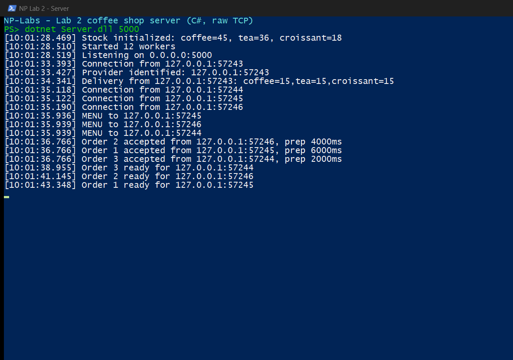

Client (terminal 2):

```powershell
dotnet run --project Lab2/csharp/Client/Client.csproj -- 127.0.0.1 5000 client
```

Then type:

```text
menu
order coffee:1
stats
quit
```

A provider is the same program with the `provider` role:

```powershell
dotnet run --project Lab2/csharp/Client/Client.csproj -- 127.0.0.1 5000 provider
deliver coffee:15 tea:15 croissant:15
```

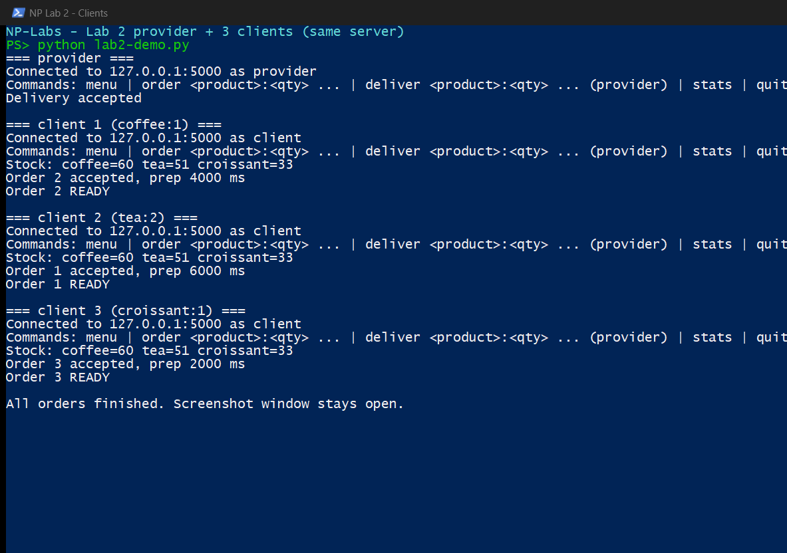

The C# server writes `Lab2/csharp/metrics/server-orders.csv`,
`server-summary.json` and, after each client, `client-orders-<pid>.csv` /
`client-summary-<pid>.json`. Generate the tables and charts with:

```powershell
python Lab2/scripts/metrics_report.py
```

The server also saves `stock-state.json` after every order, delivery and
cancellation, and reloads it at startup (stock-persistence bonus).

Phone/Go client:

```powershell
./bin/arm64/lab2-client 192.168.1.33 5000 client
# or, on Windows:
dist\win-x64\lab2-client-go.exe 127.0.0.1 5000 client
```

## 4. Lab 3 - LAN chat (UDP)

All peers use the **same port**. On Windows, open one terminal per peer:

```powershell
dotnet run --project Lab3/csharp/Chat.csproj -- Alice 9000 secret
dotnet run --project Lab3/csharp/Chat.csproj -- Bob   9000 secret
```

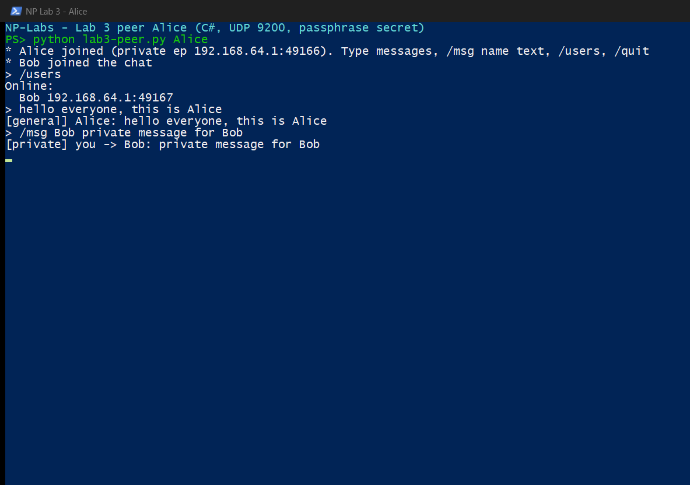

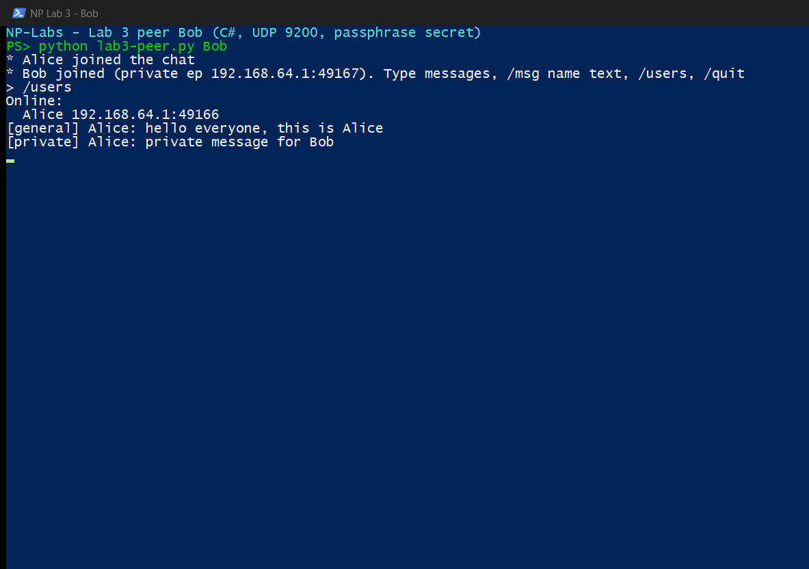

Try `/users`, a general line, and `/msg Bob hello`; `/quit` leaves and the
other peers show the leave. The datagrams are logged to
`chat-<name>-<port>.log` in the working directory.

Phone (Go peer, arm64):

```powershell
./bin/arm64/lab3-chat Phone 9000 secret
```

When the desktop has several network cards (Wi-Fi + Hyper-V/VPN), the peers send
the general channel to every interface's directed broadcast. Both
implementations also correct a peer's private IP from the datagram source, so
private messages reach the right card.

## 5. Lab 4, part 1 - HTTP broker

Create `tokens.txt` in the broker working directory (ASCII, one publisher per
line; the Go brokers also tolerate a UTF-8 BOM):

```text
tok-teacher teacher grades,news
tok-phone phone grades
```

Terminal 1 (broker):

```powershell
dotnet run --project Lab4/part1-http/broker -- http://localhost:8080/
```

The default `localhost` prefix needs no Administrator rights. For LAN access run
`enable-lan-http.ps1` once and use `http://+:8080/`.

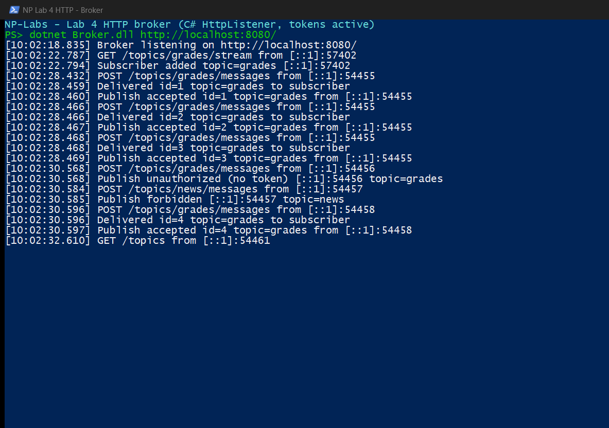

Terminal 2 (subscriber):

```powershell
dotnet run --project Lab4/part1-http/subscriber -- http://localhost:8080 grades
```

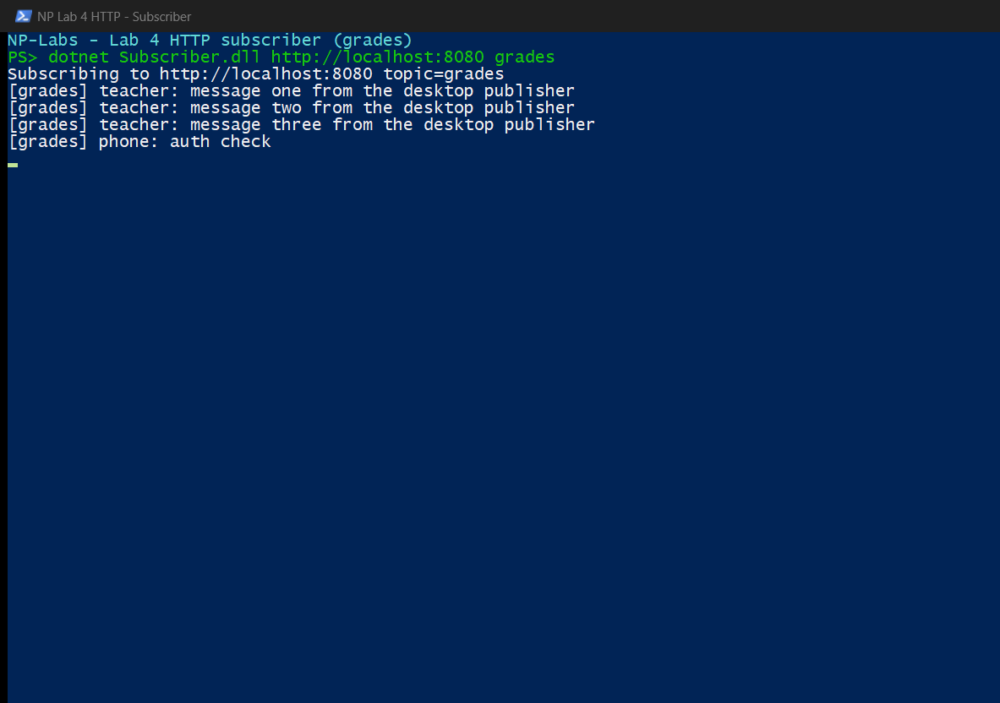

Terminal 3 (publisher; every line is one message):

```powershell
dotnet run --project Lab4/part1-http/publisher -- http://localhost:8080 grades teacher tok-teacher
```

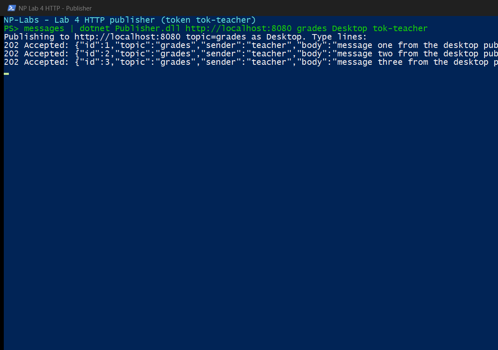

The API also answers a missing/unknown token with `401` and a valid token for a
forbidden topic with `403`:

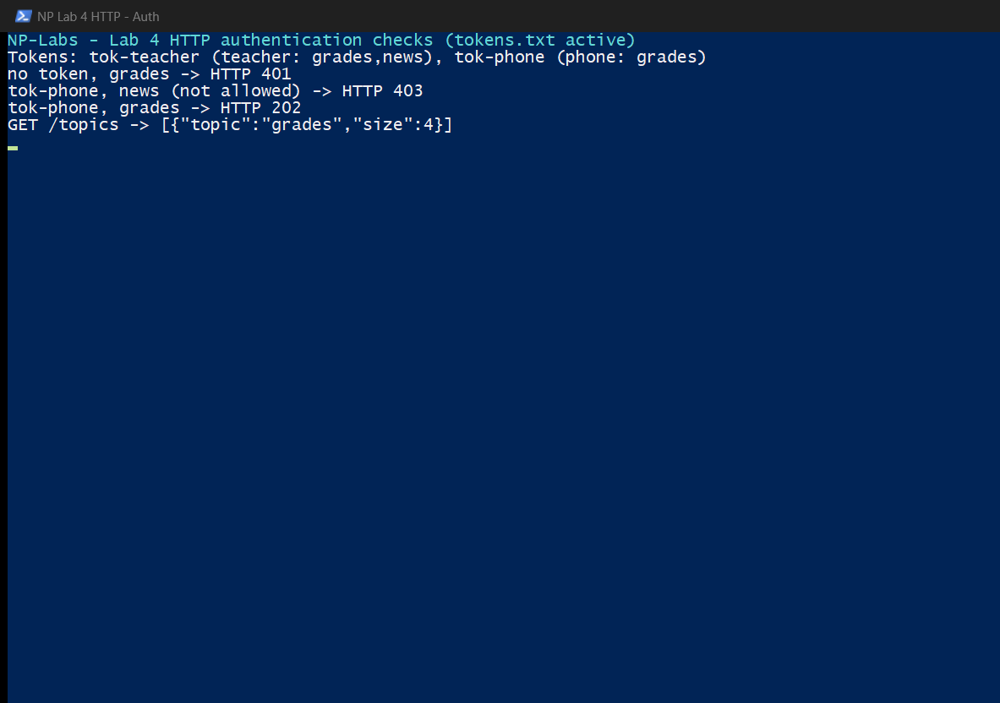

## 6. Lab 4, part 2 - gRPC broker

Terminal 1 (broker; Kestrel on port 5000):

```powershell
dotnet run --project Lab4/part2-grpc/broker
```

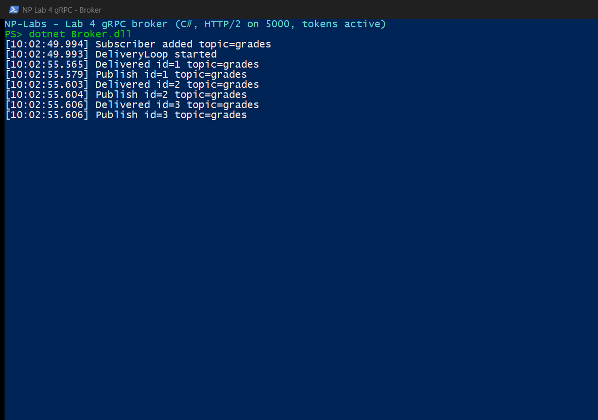

Terminal 2:

```powershell
dotnet run --project Lab4/part2-grpc/subscriber -- http://localhost:5000 grades
```

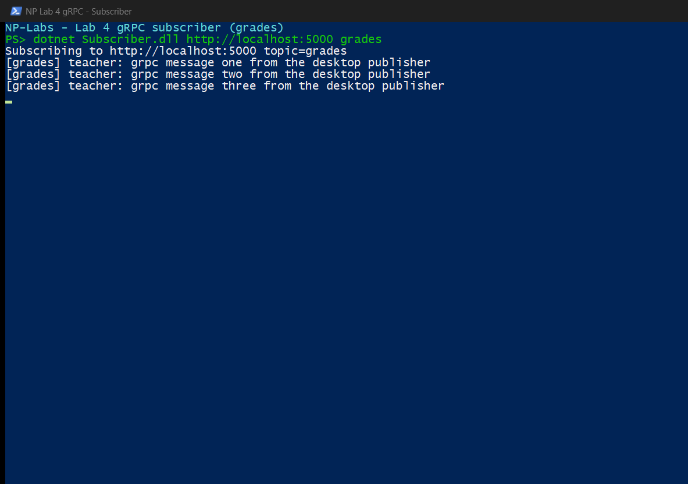

Terminal 3:

```powershell
dotnet run --project Lab4/part2-grpc/publisher -- http://localhost:5000 grades teacher tok-teacher
```

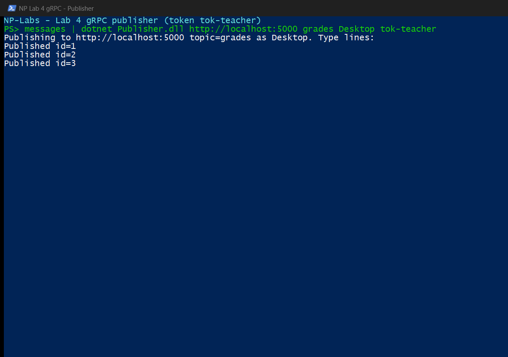

The same programs exist in Go under `Lab4/part2-grpc/go`; the Go clients work
against the C# broker (cross-language bonus) and the phone arm64 binaries are in
`bin/arm64/` (or `dist/linux-arm64/`).

## 7. Stopping and resetting

Stop each terminal with `Ctrl+C` (or `quit`/`/quit` in the interactive
programs). Runtime data lives in ignored files and folders:

```text
Lab2/csharp/metrics/  Lab2/csharp/stock-state.json
chat-*.log            Lab3 logs
broker-data/          Lab 4 persistence (per topic)
tokens.txt            Lab 4 tokens (keep your own copy)
```

Delete those to start from a clean stock, empty topics or empty chat logs.

## Troubleshooting

- **Port already in use**: find and stop the listener, e.g.
  `Get-NetTCPConnection -LocalPort 5000 -State Listen | ForEach-Object { Stop-Process -Id $_.OwningProcess -Force }`.
- **Windows Firewall prompt**: allow on Private networks, or run
  `enable-firewall.ps1` as Administrator once.
- **C# HTTP broker not reachable from another computer**: run
  `enable-lan-http.ps1` as Administrator and start the broker with
  `http://+:8080/`.
- **Chat works one way on a multi-homed desktop**: the final code sends on every
  interface; make sure both sides run the current build.
- **The chat shows a private endpoint on the wrong subnet** (for example the
  Hyper-V `192.168.64.x`): peers use the datagram source IP, so private messages
  still arrive; the phone advertises its real Wi-Fi address.
- **`tokens.txt` first token rejected**: the Go brokers strip a UTF-8 BOM; make
  sure you are on the current commit.
- **Phone `screencap` fails**: Android rejects screen capture from the Acode
  app; the phone side is verified through its logs and the desktop screenshots.
