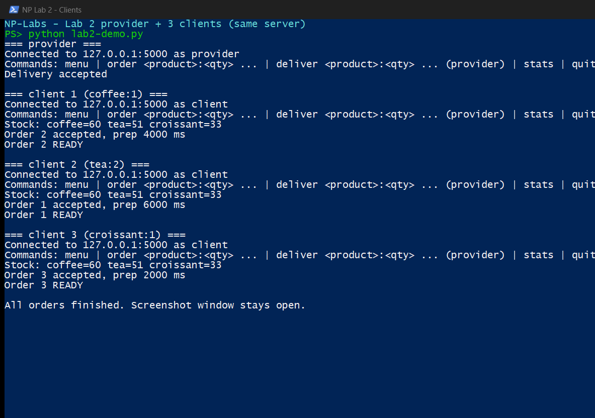
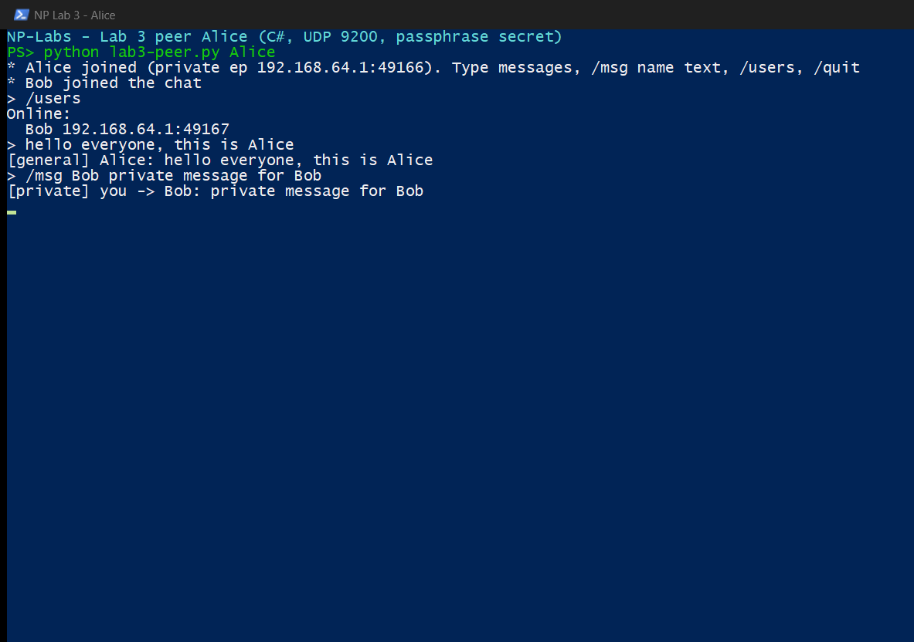
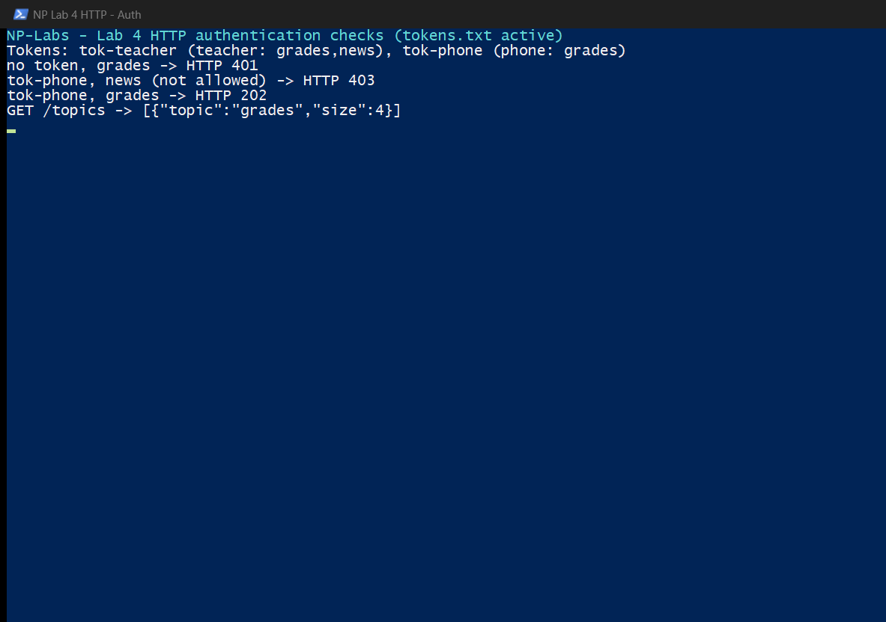
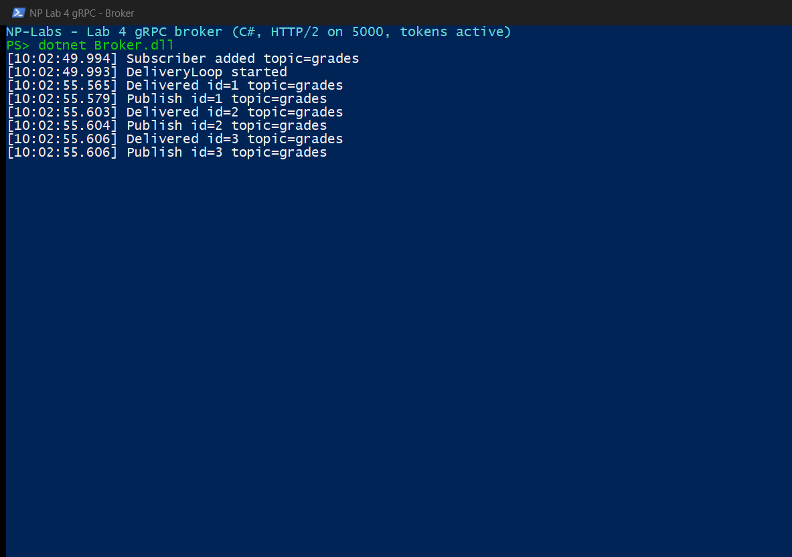

# Testing tutorial

Every item below is something the teacher can ask you to show at the defense.
Commands assume the repository root as working directory. Expected results and
the captured evidence for each lab are linked at the end.

## Test matrix

| Lab | Task | What to show | Expected |
|---|---|---|---|
| 2 | 1 | `menu`, `order coffee:1`, wait | order id + prep time right away, then `order_ready` |
| 2 | 1 | unknown product, `order coffee:0`, random bytes | error message; server keeps serving |
| 2 | 2 | 20 clients, 12 workers | all orders accepted and become ready; queue wait > 0 |
| 2 | 2 | two clients order the last croissant | exactly one accepted, one refused |
| 2 | 3 | provider `deliver`, client tries `deliver` | stock rises; client gets "only provider can deliver" |
| 2 | 3 | lower a product under 5 | immediate `alert` to the provider |
| 2 | 4 | kill a client with a queued/in-progress order | order cancelled, stock returned, other clients continue |
| 2 | 4 | kill the server | clients exit cleanly (code 0) |
| 2 | bonus | stop/start the server | stock unchanged (`stock-state.json`) |
| 3 | 1 | two+ peers, general message | all show it once, including the author |
| 3 | 2 | staggered start, `/users`, `/quit` | all peers discovered; join/leave shown |
| 3 | 2 | duplicate name | newcomer is told the name is in use |
| 3 | 3 | `/msg Bob text` | only Bob receives it (private log line on Bob) |
| 3 | 4 | wrong passphrase | encrypted private message is rejected/not shown |
| 3 | - | send random/oversized datagrams | dropped and logged, chat does not crash |
| 4 | HTTP 1 | publish, two subscribers | 202 at once; both subscribers get every message in order |
| 4 | HTTP 2 | stop/start the broker | messages kept, ids continue |
| 4 | HTTP 3 | no/unknown token; token for wrong topic | 401 (+ `WWW-Authenticate`), then 403 |
| 4 | gRPC 1 | publish, server-stream subscribe | reply with id; both subscribers receive in order |
| 4 | gRPC 2 | restart | messages kept, ids continue |
| 4 | gRPC 3 | no token / wrong topic | `Unauthenticated` / `PermissionDenied` |

## Lab 1 - quick verification

```powershell
powershell -ExecutionPolicy Bypass -File scripts/lab.ps1 check
powershell -ExecutionPolicy Bypass -File scripts/lab.ps1 verify
powershell -ExecutionPolicy Bypass -File scripts/lab.ps1 charts
```

`verify` cross-checks the totals of every task (must be 50,000,000 and equal);
`charts` regenerates `Lab1/charts/*.png` for the report. The compiled report is
`Lab1/report/report.pdf`.

## Lab 2 - coffee shop

Start a fresh server (delete `Lab2/csharp/stock-state.json` to reset the stock):

```powershell
Remove-Item Lab2/csharp/stock-state.json -ErrorAction SilentlyContinue
dotnet run --project Lab2/csharp/Server/Server.csproj -- 5000
```

### Task 1 - menu, stock, one order

```text
menu
order coffee:1
```

Expected: stock list with random 10-50 values; `Order N accepted, prep 4000 ms`
immediately; about 4 s later `Order N READY`. Unknown product, `qty=0` or
random bytes give an error and the connection stays open.

### Task 2 - many clients, shared stock

Open more clients than workers (12 workers on the test machine, 16-20 clients).
All orders must be accepted and become ready; the server metrics show a
non-zero queue wait for the clients that had to wait.

Last-item race: with exactly one croissant left, two clients order it at the
same moment. The stock lock guarantees one accepted / one refused with
`available: 0`.



### Task 3 - provider and alerts

```powershell
dotnet run --project Lab2/csharp/Client/Client.csproj -- 127.0.0.1 5000 provider
```

```text
deliver coffee:20 tea:10 croissant:10
```

Expected: `Delivery accepted`, menu stock rises. A client that sends `deliver`
gets an error. Bring a product under 5 (order it, or deliver nothing) and the
provider receives an `alert` immediately, and again when it reconnects.

### Task 4 - failures

- Start an order, then close/kill that client. The server log shows the order
  cancelled and the products returned; other orders finish normally.
- Kill the server (`Ctrl+C` or `Stop-Process`). C#, Go and Rust clients print
  `[server gone]` and exit with code 0.
- Send random bytes or a 100 KB line: the server answers with an error and
  keeps serving.

### Bonus - stock persistence

Order one coffee, stop the server, start it again. The startup log must say:

```text
Stock loaded from stock-state.json: coffee=..., tea=..., croissant=...
```

The stock is the same as before the restart (C# and Go servers).

### Metrics report

```powershell
python Lab2/scripts/metrics_report.py
```

Writes `Lab2/csharp/metrics/report.md` and four SVG charts. The report merges
every `client-orders-<pid>.csv`, so several clients can contribute at once.

## Lab 3 - LAN chat

Start two peers on the same port (9000) with different names. Verify:

1. `/users` lists both within a second; join is shown.
2. A plain line reaches both peers in the general channel once.
3. `/msg Bob hello` is shown only by Bob; the sender sees `you -> Bob`.
4. `/quit` is shown as `* Alice left the chat` by the remaining peers.
5. A third peer with an existing name is rejected as "name in use".



For Task 4, use the same passphrase on all peers. With a wrong/missing
passphrase, the encrypted private message cannot be decrypted and is not shown.
General messages stay unencrypted by design.

Invalid input test: send random bytes to the chat port (`nc -u` or a small
script). The peer logs a `DROP ... invalid_json` line and keeps running. A
message over 500 characters is dropped and logged as too long.

Same-port test (three peers on one computer): all three receive the general
channel, the private message reaches only its target, and all see the leave.
See `Lab3/evidence/local-multi-peer-2026-11-26/`.

## Lab 4 - message broker

Put a `tokens.txt` next to the broker (ASCII):

```text
tok-teacher teacher grades,news
tok-phone phone grades
```

### Part 1 - HTTP

Start the broker with the localhost prefix (no admin) and two subscribers:

```powershell
dotnet run --project Lab4/part1-http/broker -- http://localhost:8080/
dotnet run --project Lab4/part1-http/subscriber -- http://localhost:8080 grades
dotnet run --project Lab4/part1-http/subscriber -- http://localhost:8080 grades
```

Publish from two publishers at the same time:

```powershell
dotnet run --project Lab4/part1-http/publisher -- http://localhost:8080 grades teacher tok-teacher
dotnet run --project Lab4/part1-http/publisher -- http://localhost:8080 grades phone tok-phone
```

Expected: each publish gets `202 Accepted` with a unique id and a timestamp;
both subscribers see every message in order. `GET /topics` lists the topic and
its size.

Restart test: stop the broker, start it again, publish once more. The id
continues (for example 7 after a restart that follows ids 1-6) and the old
messages are still on disk under `broker-data/`.

Auth test:

```powershell
# 401 + WWW-Authenticate: Bearer
curl.exe -i -X POST -H "Content-Type: application/json" -d '{"sender":"x","body":"x"}' http://localhost:8080/topics/grades/messages
# 403 (valid token, topic not allowed)
curl.exe -i -X POST -H "Authorization: Bearer tok-phone" -H "Content-Type: application/json" -d '{"sender":"x","body":"x"}' http://localhost:8080/topics/news/messages
# 202 (valid token + allowed topic)
curl.exe -i -X POST -H "Authorization: Bearer tok-phone" -H "Content-Type: application/json" -d '{"sender":"x","body":"x"}' http://localhost:8080/topics/grades/messages
```



With auth enabled the stored sender is the token owner (`teacher` / `phone`),
not the name claimed in the JSON body.

### Part 2 - gRPC

```powershell
dotnet run --project Lab4/part2-grpc/broker
dotnet run --project Lab4/part2-grpc/subscriber -- http://localhost:5000 grades
dotnet run --project Lab4/part2-grpc/publisher -- http://localhost:5000 grades teacher tok-teacher
```

Expected: `Published id=N`, the subscriber receives the message; a second
subscriber also receives it. The broker has **no HTTP API** in this part.
Restart: stop the broker, start it, publish again; the id continues.

Auth: publish without a token is rejected as `Unauthenticated`; a valid token
for `news` is rejected as `PermissionDenied`; `grades` succeeds with the token
owner as sender. The token travels in the `authorization` metadata (the C# and
Go clients also accept it in the request field).



## Cross-device checklist (phone + PC)

The phone runs the arm64 Go binaries from `bin/arm64/` (or
`dist/linux-arm64/`); the desktop can run the C# or Go programs.

- **Lab 2**: server on the PC (`0.0.0.0:5000`), provider + clients on the phone.
  Bonus: this is the two-computers + two-languages bonus.
- **Lab 3**: phone `./bin/arm64/lab3-chat Phone 9000 secret`, desktop
  `dotnet run --project Lab3/csharp/Chat.csproj -- Desktop 9000 secret`. Use
  `/users`, general, `/msg Desktop ...`; the datagram logs are the proof.
- **Lab 4 HTTP**: broker on the PC (run `enable-lan-http.ps1` for the C#
  `http://+:8080/` prefix, or use the Go broker which binds the LAN directly);
  phone Go publisher/subscriber use `http://<pc-ip>:8080`.
- **Lab 4 gRPC**: C# broker on the PC (`:5000`), phone Go publisher/subscriber
  use `<pc-ip>:5000`; cross-language bonus.

Captured cross-device evidence:

| Lab | Folder | Result |
|---|---|---|
| 2 | `Lab2/evidence/cross-device-2026-11-26/` | 16 phone clients on 12 workers, 16/16 ready |
| 2 | `Lab2/evidence/stock-persistence-2026-11-26/` | C# and Go stock survives restarts |
| 3 | `Lab3/evidence/cross-device-2026-11-26/` | general + encrypted private both ways |
| 3 | `Lab3/evidence/local-multi-peer-2026-11-26/` | 3 peers, same port, all checks pass |
| 4 | `Lab4/evidence/cross-device-2026-11-26/` | HTTP + gRPC, 2 pubs + 2 subs, auth, restart |

## Expected pass markers

- Lab 2 server: `Started 12 workers`, `Order ... accepted`, `Order ... ready`.
- Lab 2 clients: all `Order N READY`; no `refused` unless you test the race.
- Lab 3: `Online:` lists the other peer; `[private] Alice: ...` only on Bob.
- Lab 4 HTTP: `202 Accepted` with increasing ids; subscribers show the same
  messages in order; `401`, `403`, `202` for the three auth cases.
- Lab 4 gRPC: `Published id=N`; `Unauthenticated`, `PermissionDenied`, success.

## Troubleshooting

- **Nothing reaches the other computer**: allow the ports
  (`enable-firewall.ps1`), use the same Wi-Fi/hotspot, and for the C# HTTP
  broker run `enable-lan-http.ps1`.
- **Chat sees only one direction**: update both peers; the fixed versions send
  the general channel on every interface and correct the private IP from the
  datagram source.
- **First token rejected (401)**: you are on an old Go broker build; the current
  one strips a UTF-8 BOM from `tokens.txt`.
- **`client-summary.json` missing**: clients now write
  `client-summary-<pid>.json` and `client-orders-<pid>.csv`, one set per client.
- **Metrics report has no client rows**: run at least one C# client in the same
  working directory as the server (the Go client writes console output, not
  CSVs).
- **Broker restart reuses ids**: stop all broker processes, then use the same
  working directory so `broker-data/` is reused.
